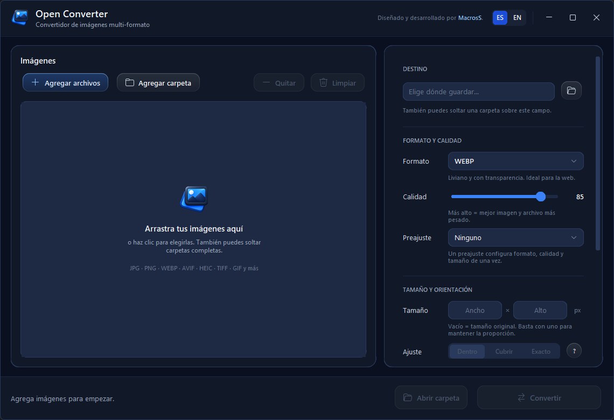

<p align="center">
  
</p>

<h1 align="center">Open Converter</h1>

<p align="center">Convertidor de imágenes multi-formato para Windows, macOS y Linux, con ventana y línea de comandos.</p>

<p align="center">
  <a href="https://github.com/macross95/open-converter/releases/latest"></a>
  <a href="https://github.com/macross95/open-converter/releases/latest"></a>
  <a href="https://github.com/macross95/open-converter/releases/latest"></a>
</p>

<p align="center"><a href="https://macross95.github.io/open-converter/">Sitio web</a> · <a href="https://github.com/macross95/open-converter/releases">Todas las versiones</a></p>

<p align="center">
  
</p>

## Funciones

- Convierte entre JPG, PNG, WEBP, AVIF, HEIC, TIFF, GIF, BMP, ICO y más de 20 formatos adicionales.
- Lotes completos: arrastra archivos o carpetas enteras a la ventana.
- Redimensionar (dentro, cubrir o exacto), rotar, voltear y escala de grises.
- Calidad ajustable y preajustes listos: Web, Miniatura, Impresión, Sin pérdida y Redes sociales.
- Metadatos: conservar (fecha, cámara, GPS), selectivo (sin ubicación ni números de serie) o eliminar.
  El perfil de color se conserva siempre para que los colores no cambien.
- Nunca sobrescribe el archivo original: si el nombre ya existe en el lote, agrega " (1)".
- Interfaz en español e inglés; recuerda tus últimas preferencias.

## Instalación

Descarga el instalador de tu sistema desde la sección [**Releases**](../../releases/latest) y verifica la suma con `SHA256SUMS.txt`.

| Sistema | Archivo | Cómo instalar |
|---|---|---|
| Windows 10 y 11 | `Open.Converter-Setup-x.y.z.exe` | Ejecútalo. No requiere permisos de administrador. |
| macOS 11 o superior | `Open-Converter-x.y.z-macos-arm64.dmg` (Apple Silicon) o `-x64.dmg` (Intel) | Abre el `.dmg` y arrastra el programa a Aplicaciones. La primera vez ábrelo con clic derecho → Abrir, porque no está firmado con un certificado de Apple. |
| Linux (Ubuntu 22.04 o superior) | `Open-Converter-x.y.z-linux-x64.tar.gz` | `tar -xzf Open-Converter-*.tar.gz && ./install.sh`. Se instala solo para tu usuario y aparece en el menú de aplicaciones. Para quitarlo: `./install.sh --uninstall`. |

Los archivos SVG necesitan la biblioteca Cairo en macOS y Linux (`brew install cairo` o `sudo apt install libcairo2`). Sin ella, el resto de los formatos funciona igual.

### Desde el código fuente

Requiere Python 3.10 o superior con Tk.

**Windows**

```bat
git clone https://github.com/macross95/open-converter.git
cd open-converter
install.bat
```

**macOS**

```sh
brew install python-tk
git clone https://github.com/macross95/open-converter.git
cd open-converter
./install.sh
```

**Linux (Ubuntu o Debian)**

```sh
sudo apt install python3-venv python3-tk libcairo2
git clone https://github.com/macross95/open-converter.git
cd open-converter
./install.sh
```

El instalador crea un entorno `.venv` con todos los formatos opcionales. Para probarlo sin instalar nada:
`run.bat` (Windows) o `./run.sh` (macOS y Linux) abren la ventana.

## Uso por línea de comandos

```sh
openconverter                                   # abre la ventana
openconverter convert foto.heic foto.webp --quality 85 --resize 1920x
openconverter convert foto.jpg foto.png --metadata selective
openconverter batch .\entrada .\salida --format webp --preset web
openconverter info foto.jpg
openconverter formats
```

## Compilar el ejecutable y el instalador

Cada sistema se compila en su propio sistema (PyInstaller no compila de uno a otro):

```sh
python -m pip install -e ".[all,dev]"
python -m PyInstaller "Open Converter.spec" --noconfirm --clean
```

- **Windows:** `"%LOCALAPPDATA%\Programs\Inno Setup 6\ISCC.exe" installer.iss` deja el instalador en `installer_output\`.
  Requiere [Inno Setup](https://jrsoftware.org/isinfo.php) 6.5 o superior. Las imágenes del instalador se generan con `python installer\make_art.py`.
- **macOS:** deja `dist/Open Converter.app`.
- **Linux:** deja `dist/open-converter/`.

Los instaladores oficiales los compila GitHub Actions (`.github/workflows/compilar.yml`) en los tres sistemas
al subir una etiqueta de versión: `git tag v0.4.0 && git push origin v0.4.0`. La etiqueta debe coincidir con
`__version__` de `src/openconverter/__init__.py`.

## Estructura

```
src/openconverter/
  core/        conversión, transformaciones, metadatos y registro de formatos
  adapters/    lectura y escritura por formato (Pillow, HEIF, RAW, SVG, imageio)
  gui/         ventana (CustomTkinter), barra de título propia en Windows (win_frame.py) e íconos dibujados (vector_icons.py)
  cli/         línea de comandos
  i18n.py      textos en español e inglés
  platform_utils.py  diferencias entre Windows, macOS y Linux (ajustes, tipografías, atajos)
assets/        logo e ícono
installer/     imágenes del instalador de Windows
packaging/     archivos de instalación para Linux
tests/         pruebas (pytest)
```

Más detalles en [docs/architecture.md](docs/architecture.md).

## Pruebas

```bat
python -m pytest
```

## Créditos

Diseñado y desarrollado por [**MacrosS**](https://www.linkedin.com/in/felipelucero/). Construido con [Pillow](https://python-pillow.org),
[CustomTkinter](https://github.com/TomSchimansky/CustomTkinter),
[tkinterdnd2](https://github.com/Eliav2/tkinterdnd2) y
[pillow-heif](https://github.com/bigcat88/pillow_heif).

## Licencia

MIT. Ver [LICENSE](LICENSE).
